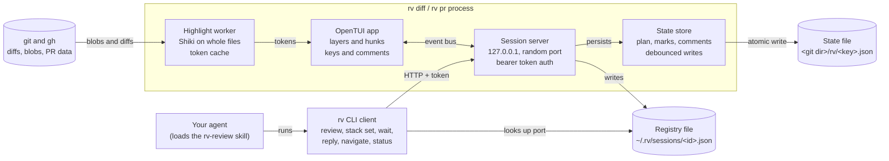

# rv 1.0 — Build Spec

Nov 26, 2026 · Derry

## Overview

rv is a terminal tool for reviewing large pull requests. Your own coding agent breaks a PR into ordered layers, and you review it layer by layer, the way CodeRabbit's Change Stack works. Any agent can drive it, through a CLI and a bundled skill, the same way agents drive Hunk.

**Goals for 1.0**

- Review a PR or local branch as a stack of ordered layers, each with a title, a "why" and a risk level.
- Guarantee every hunk is in exactly one layer, so nothing gets skipped.
- Two-way loop: the human comments or asks questions in the TUI, the agent answers inline.
- Syntax-highlighted diffs, with Synthwave '84 as the default theme.
- Submit the review to GitHub with inline comments, or export it as markdown.

**Not in 1.0:** split view, jj or Sapling support, several agents in one session, a web UI.

**Conventions for the agent building this**

- Bun + TypeScript, strict mode, no `any` in core modules.
- Commits are authored as the repo owner (Derry). Add no Claude author or `Co-Authored-By` trailers.
- Small commits, one per milestone step, conventional commit messages (`feat:`, `fix:`, `test:`).
- Keep core logic (`src/core`) free of UI imports so it can be unit tested.

## Stack and architecture

The TUI owns the review session and exposes it on a loopback HTTP server. Every other `rv` subcommand is a thin client that finds that server through a registry file.



The agent never touches the TUI or the state directly. It runs CLI commands, which find the session through the registry and call its server, and the server pushes changes to the app over an in-process event bus.

**Stack**

| Concern | Choice |
| --- | --- |
| Runtime | Bun (latest stable), shipped as a single binary via `bun build --compile` |
| TUI | OpenTUI with `@opentui/react` |
| Highlighting | Shiki (`shiki` + bundled themes and languages) |
| Diff parsing | Own unified-diff parser in `src/core/diff.ts` (no dependency) |
| GitHub | `gh` CLI (`gh pr diff`, `gh pr view --json`, `gh api`) |
| Tests | `bun test`; tmux for end-to-end |

**Session server**

- `rv diff` or `rv pr` starts the TUI, which starts `Bun.serve` on `127.0.0.1`, port 0 (random).
- It generates a 32-byte random token. Every request needs `Authorization: Bearer <token>`.
- It writes `~/.rv/sessions/<sessionId>.json`: `{ id, pid, port, token, repoRoot, base, head, prNumber?, startedAt }`, with file mode `0600`.
- It deletes that file on exit (SIGINT, SIGTERM, normal quit). Clients ignore entries whose pid is dead and remove them.

**Client discovery**

- Default: the session whose `repoRoot` matches `git rev-parse --show-toplevel` of the current directory.
- Several matches: use `--session <id>`, otherwise fail with the list.
- No match: exit code 3 with "no live rv session for this repo, start one with rv diff or rv pr".

**Source layout**

- `src/core/` holds the diff parser, hunk IDs, plan validator, state store and highlighter. No UI imports.
- `src/server/` holds the HTTP routes and the session event bus.
- `src/tui/` holds the OpenTUI app.
- `src/cli/` holds the argument parsing and one file per subcommand.
- `skill/SKILL.md` is the bundled agent skill.

## Data model

Everything hangs off a stable hunk ID. The agent's plan, the reviewed marks and every comment reference hunks by that ID.

**Hunk IDs**

- ID = the first 10 hex characters of `sha1(path + "\n" + hunkBody)`. `hunkBody` is the hunk's `+`, `-` and context lines, without the `@@` header.
- Leaving out the header line numbers is deliberate. A push that changes an earlier hunk shifts the line numbers of later ones, and their IDs must not change.
- Identical hunks in one file get `-2`, `-3` suffixes in order of appearance.
- Binary files, pure renames and mode-only changes each become one pseudo-hunk, so they count towards coverage too.

**Types (`src/core/types.ts`)**

```ts
type DiffLine = { kind: 'add' | 'del' | 'ctx'; oldNo?: number; newNo?: number; text: string };
type Hunk = {
  id: string; path: string; oldPath?: string;
  fileStatus: 'added' | 'modified' | 'deleted' | 'renamed' | 'binary' | 'mode';
  header: string; oldStart: number; oldLines: number; newStart: number; newLines: number;
  lines: DiffLine[];
};
type Layer = {
  id: string;            // "L1", "L2", ...
  group?: string;        // optional cohort name; the sidebar groups layers by it
  title: string;         // at most 60 characters
  why: string;           // markdown, at most 800 characters
  risk: 'low' | 'med' | 'high';
  dependsOn?: string[];  // earlier layer ids only
  hunks: string[];       // hunk ids, in reading order
};
type Plan = { version: 1; title: string; summary?: string; layers: Layer[] };
type Comment = {
  id: string;            // "c_" + 8 random characters
  hunkId: string;
  line?: { side: 'old' | 'new'; number: number };
  author: 'human' | 'agent';
  kind: 'review' | 'ask' | 'note' | 'reply';
  parentId?: string;     // a reply points at its ask
  body: string;          // markdown
  status: 'draft' | 'pending' | 'answered' | 'resolved';
  createdAt: string;     // ISO 8601
};
```

Comment kinds: `review` is a review comment that goes to GitHub or the export. `ask` is a question or instruction for the agent. `note` is an annotation the agent adds unprompted. `reply` is the agent's answer to an `ask`.

**Plan validation (`rv stack set`)**

A plan is accepted only if all of these hold:

1. Every hunk ID in the current diff appears in exactly one layer.
2. No unknown hunk IDs.
3. Layer IDs are unique, there are 1 to 30 layers, and no layer is empty.
4. `dependsOn` only points at layers earlier in the list, so there are no cycles.
5. Titles and `why` are within their length limits, and `risk` is one of the three values.

On failure it exits with code 2 and prints JSON the agent can act on directly:

```json
{ "ok": false,
  "missing":    [{ "id": "3f9a1c22be", "path": "src/api/user.ts", "header": "@@ -40,6 +40,9 @@" }],
  "duplicated": [{ "id": "a01b77e4c0", "layers": ["L2", "L4"] }],
  "unknown":    ["deadbeef00"],
  "errors":     ["L3.dependsOn references L5, which comes later"] }
```

**Stale plans**

When the diff reloads (with `--watch`, `rv reload` or `R`), the plan is kept. Hunks that disappeared are dropped from their layers. New hunks go into a generated `Unplaced` layer at the end. The TUI shows a "plan is stale, N new hunks" banner, and `rv stack get` returns `stale: true` with the new IDs.

**Saved state**

- Path: `<git dir>/rv/<key>.json`. The key is `pr-<number>` for PRs, or `<base>..<head>` with `/` replaced by `_` for local ranges.
- Contents: `{ plan, reviewed: { [hunkId]: isoTimestamp }, comments: Comment[], updatedAt }`.
- Written atomically (write a temp file, then rename), debounced to 250 ms.

## CLI reference

The human uses two commands to open a review. Everything else is for the agent, and every agent command supports `--json` and works against the live session for the current repo.

**Opening a review (human)**

| Command | Behaviour |
| --- | --- |
| `rv diff [range] [-- paths]` | Default range is `merge-base(origin/HEAD, HEAD)..HEAD`. Accepts `a..b`, `a...b` or a single ref. Flags: `--staged`, `--worktree` (include uncommitted changes), `--watch`, `--theme <name>`, `--transparent`. |
| `rv pr <number or url>` | Uses `gh pr view --json baseRefName,headRefOid,number,url` and fetches `pull/<n>/head` when the commit is missing locally. Diffs merge-base..head. Same flags as `rv diff`. |
| `rv reload [-- <diff args>]` | Reloads the open session, optionally pointing it at a new range. |

**Agent commands**

| Command | Does | Returns |
| --- | --- | --- |
| `rv session list` | Lists live sessions | `[{ id, repoRoot, base, head, prNumber }]` |
| `rv review` | Files and hunks in the session. `--patch` adds the line text, `--layer <id>` and `--unreviewed` filter. | `{ files: [{ path, status, hunks: [{ id, header, added, removed, lines? }] }] }` |
| `rv stack get` | The current plan | `{ plan, stale, newHunks }` |
| `rv stack set --stdin` or `--file p.json` | Validates and installs a plan, and the TUI switches to layer view | `{ ok: true }`, or the validation error JSON with exit code 2 |
| `rv note add --hunk <id> --body <md>` | Adds an agent note. `--line new:42` anchors it to a line, `--stdin` reads the body. | `{ id }` |
| `rv comments` | Lists comments. Filters: `--kind ask`, `--pending`. | `Comment[]` |
| `rv reply --to <commentId> --body <md>` | Answers an ask and marks it `answered` | `{ id }` |
| `rv wait [--timeout 600]` | Blocks until the human sends asks or ends the review. Each ask is returned once. | `{ event: 'asks', asks: Comment[] }`, `{ event: 'done' }` or `{ event: 'timeout' }` |
| `rv navigate` | Moves the TUI with `--layer <id>`, `--hunk <id>` or `--comment <id>` | `{ ok: true }` |
| `rv status` | Review progress | `{ layers: [{ id, reviewed, total }], pendingAsks }` |
| `rv export --md [--out f]` | Markdown review (format below) | markdown on stdout |
| `rv submit` | Posts the GitHub review. Only when the human asks. | `{ url }` |
| `rv skill path` | Prints the bundled SKILL.md path | path |

**Exit codes:** 0 success, 1 general error, 2 plan validation failed, 3 no live session, 4 bad token or version mismatch between client and session.

**HTTP routes (internal, behind the bearer token):** `GET /review`, `GET /stack`, `PUT /stack`, `GET /comments`, `POST /comments`, `POST /comments/:id/reply`, `GET /wait` (long poll, held for up to `timeout` seconds), `POST /navigate`, `GET /status`, `GET /export`, `GET /health` (returns the version). The CLI is the only supported client, and the skill never tells agents to call the routes directly.

**Markdown export format** (one section per layer, in plan order):

```markdown
# Review: <plan title>
## L2 · Persist sessions (risk: med)
### src/session/store.ts @@ -40,6 +40,9 @@ (line new:44)
> [review] This swallows the write error, surface it.
> [ask] Why debounce at 250 ms here? → [reply] Matches the state file writer.
```

## TUI

Two panes: layers on the left, the current layer's hunks on the right. Until the agent posts a plan, everything sits in one `Unstacked` layer in file order, so rv is still useful with no agent.

**Layout**

```text
 rv · Add session persistence · main..feat/sessions · PR #482          23/61 hunks · agent waiting
┌ Layers ─────────────────────────┐┌ L2 · Persist sessions to disk                        risk: med ─┐
│ Storage                         ││ Why: sessions now survive restarts. The store writes a JSON  │
│  ✓ L1 Session schema   low  4/4 ││ file per session; everything in L3 depends on this.          │
│  ▸ L2 Persist sessions med  2/7 ││ Depends on: L1                                               │
│ API                             ││                                                              │
│    L3 Resume endpoint  high 0/9 ││ src/session/store.ts  modified  +38 −12                      │
│    L4 Client retry     low  0/5 ││ @@ -40,6 +40,9 @@ export class SessionStore                   │
│ Tests                           ││  40  40   async save(s: Session) {                           │
│    L5 Store tests      low  0/6 ││  41     -   fs.writeFileSync(this.path(s.id), JSON.stringify(s))│
│                                 ││      41 +   await atomicWrite(this.path(s.id), s)            │
│                                 ││         ┌ ask · you · pending ────────────────────────┐      │
│                                 ││         │ What happens if two tabs save at once?     │      │
│                                 ││         └────────────────────────────────────────────┘      │
│                                 ││  ✓ src/session/types.ts @@ -1,4 +1,12 @@ (collapsed, 12 lines)│
└─────────────────────────────────┘└──────────────────────────────────────────────────────────────┘
 space reviewed · c comment · ? ask agent · S send (1) · ]/[ layer · n/p hunk · H help
```

- **Header:** plan title, range, PR number, overall progress, and agent state ("agent waiting" while a client holds `rv wait` open, otherwise "agent idle"). When the plan is stale, a banner appears under the header.
- **Layers pane:** about 34 columns wide, toggled with `b`. Layers are grouped by `group`, each showing its risk badge and reviewed/total count, with a tick once complete.
- **Main pane:** the layer card (title, risk, rendered `why`, depends on) and then that layer's hunks in plan order. Each has a file header (path, status, +/− counts), the hunk header, old/new line numbers in the gutter, and the code with syntax highlighting.
- **Comments:** threads render inline under their anchor line, or after the hunk if they have none. Boxes are labelled with kind, author and status.
- **Reviewed hunks** collapse to one line with a tick. `o` expands one again.
- **Narrow terminals:** under 100 columns the layers pane hides automatically, and `b` shows it as an overlay.

**Keybindings**

| Key | Action |
| --- | --- |
| `j` / `k`, arrows | Move cursor one line |
| `Ctrl-d` / `Ctrl-u` | Half page down / up |
| `g` / `G` | Top / bottom of layer |
| `n` / `p` | Next / previous hunk |
| `]` / `[` | Next / previous layer |
| `N` | Jump to the next unreviewed hunk in any layer |
| `Tab` | Switch focus between panes; `Enter` in the layers pane opens a layer |
| `space` | Mark hunk reviewed and move to the next hunk (press again to unmark) |
| `V` | Mark the whole layer reviewed |
| `o` | Expand or collapse the current hunk |
| `c` | Review comment on the cursor line |
| `?` | Ask the agent about the cursor line |
| `e` / `d` / `r` | Edit own comment / delete a draft / resolve thread |
| `S` | Send all draft asks to the agent |
| `E` | Export markdown (clipboard via OSC 52, and `<git dir>/rv/export.md`) |
| `P` | Submit to GitHub (picker: Comment, Approve, Request changes, Draft; then confirm) |
| `R` | Reload the diff |
| `w` | Toggle line wrap |
| `b` | Toggle layers pane |
| `H` | Help overlay |
| `q` | Quit; confirms if there are unsent asks or unsubmitted review comments |

Mouse: the wheel scrolls the pane under the pointer, and clicking a layer opens it.

**Comment editor:** opens as a box at the bottom. `Enter` saves, `Ctrl-j` adds a newline, `Ctrl-e` opens `$EDITOR` for long text, `Esc` cancels. Asks stay as drafts until `S`, unless `asks.autoSend = true` in config.

**Performance**

- Each layer is flattened into a row model (layer card rows, file headers, hunk headers, diff lines, comment rows). Only the rows in view plus a 50-row buffer are rendered.
- Targets: first paint under 500 ms for a 5,000-line diff, before highlighting finishes. Scrolling must never wait on highlighting.
- Server events (new plan, note, reply, navigate) reach the UI through an in-process event bus, and the UI re-renders only the affected layer.

## Syntax highlighting and theming

Highlighting uses Shiki on whole files, not hunk fragments. The default theme is Synthwave '84, colours only, and the theme drives the whole interface, not just the code.

**Highlighting pipeline (`src/core/highlight.ts`)**

1. For each file, read the old blob (`git show <base>:<oldPath>`) and the new one (`git show <head>:<path>`, or the working-tree file with `--worktree`).
2. Pick the language from the extension and filename through Shiki's bundled language aliases. Unknown means plain text.
3. Tokenize each whole file with `codeToTokens`, giving tokens per line. A deleted line takes `oldTokens[oldNo - 1]`, and an added or context line takes `newTokens[newNo - 1]`. This is why multi-line strings, comments and JSX that begin above a hunk still colour correctly.
4. Use the JavaScript regex engine (`shiki/engine/javascript`) so the compiled binary needs no Oniguruma WASM. Check the 20 most common languages render the same as with Oniguruma, and log any grammar that fails.
5. Run highlighting in a Bun Worker with a priority queue: the visible layer first, then the next layer, then the rest. Rows render plain until their tokens arrive.
6. Cache tokens by `<blob sha>:<theme>:<language>`, in memory (LRU, 200 files) and on disk under `~/.cache/rv/tokens/`. Blob SHAs come from `git rev-parse <rev>:<path>`.
7. Skip highlighting (plain add/remove colours only) for files over 5,000 lines or 500 KB, lines over 2,000 characters, minified files and lockfiles (`*.min.js`, `package-lock.json`, `bun.lock`, `yarn.lock`, `pnpm-lock.yaml`, `Cargo.lock`).

**Word-level changes**

- Within each hunk, pair runs of deleted and added lines in order, the way GitHub does.
- For each pair, compute a word diff (`diffWordsWithSpace` from the `diff` package). Show it only when at least 20% of the line is unchanged, otherwise the emphasis is noise.
- Changed words get the stronger emphasis tint, and syntax colours stay on top.

**Theme**

- Default `theme = "synthwave-84"`, loaded from Shiki's bundled themes. Any bundled Shiki theme name, or a path to a VS Code theme JSON, also works.
- Colours only. The VS Code glow effect is a separate CSS injection and isn't part of the theme JSON. Don't imitate it with bold, blink or bright variants.
- Interface colours come from the theme's `colors` map. Don't hardcode hex values for the UI:

| UI element | Theme key | Fallback |
| --- | --- | --- |
| App background | `editor.background` | terminal default |
| Text | `editor.foreground` | terminal default |
| Layers pane | `sideBar.background` | app background |
| Gutter numbers | `editorLineNumber.foreground` | text at 50% |
| Focus border, current layer | `focusBorder`, then `tab.activeBorder` | `terminal.ansiMagenta` |
| Added / removed line tint | `diffEditor.insertedLineBackground`, `diffEditor.removedLineBackground` | green / red at 15% over background |
| Changed-word emphasis | `diffEditor.insertedTextBackground`, `diffEditor.removedTextBackground` | green / red at 35% over background |
| Risk badges low / med / high | `terminal.ansiGreen`, `terminal.ansiYellow`, `terminal.ansiRed` | named ANSI colours |
| Ask / reply and note / review borders | `terminal.ansiCyan`, `terminal.ansiMagenta`, `editor.foreground` | named ANSI colours |

- Terminals have no alpha, so composite any `#RRGGBBAA` colour over the app background before use.
- Truecolor is the target. If `COLORTERM` isn't `truecolor` or `24bit`, quantize to the 256-colour palette.
- rv paints its own background by default, so it looks the same whatever the terminal theme. `--transparent` (or `transparent = true`) leaves the background unpainted but keeps the line tints.

## Skill, GitHub and config

The skill is the only integration with an agent. Any agent that can load a skill and run shell commands can drive rv.

**Skill (`skill/SKILL.md`)**

Ships inside the binary's assets. `rv skill path` prints where it was extracted (`~/.rv/skill/SKILL.md`, refreshed on version change). Frontmatter:

```markdown
---
name: rv-review
description: Use when a live rv session is open for this repo, or the user asks you to plan or walk them through a review in rv. Builds a layered review plan for the diff and answers the reviewer's questions.
---
```

The body teaches this workflow:

1. **Find the session.** `rv session list --json`. If none exists, tell the user to run `rv diff` or `rv pr <n>`. Never start one yourself, since it's an interactive TUI.
2. **Read the change.** `rv review --json --patch`. For very large diffs, read without `--patch` first, then file by file.
3. **Build the plan.**
    - Group into cohorts (`group`), then ordered layers. Foundations come before what depends on them: types, schema and config, then core logic, then API surfaces, then UI.
    - Tests go in the layer they cover, or straight after it if they're large.
    - Mechanical changes (renames, formatting, generated code, lockfiles) go in a final low-risk layer.
    - Aim for 3 to 12 layers of no more than about 400 changed lines each.
    - `why` explains intent and what to check, and never just restates the diff. If you wrote the change, use what you know about why.
    - Risk is `high` for auth, data migrations, concurrency, money and public APIs; `med` for core logic; `low` for the rest.
4. **Submit.** `rv stack set --stdin`. On exit code 2, fix the plan from the error JSON and resubmit. Never drop hunks to pass validation.
5. **Notes, sparingly.** `rv note add` only for things that aren't obvious: at most one per hunk and about 10 in total.
6. **Answer questions in a loop.** Run `rv wait --timeout 600`.
    - On `asks`: answer each with `rv reply`, using `rv navigate` to point at code you mention.
    - On `timeout`: wait again.
    - On `done`: stop.
    - If an ask requests a code change, make it only if the user has allowed edits in this session. Otherwise reply with the proposed patch. After editing, run `rv reload`.
7. **Never** run `rv submit` unless the user asks, and never call the HTTP routes directly.

The README covers installing it: symlink the file into `~/.claude/skills/rv-review/`, the Codex or opencode skills folder, or paste `rv skill path` output into any agent's instructions.

**GitHub**

- `rv pr` needs `gh auth status` to pass. If it doesn't, show the `gh auth login` hint and exit 1.
- `rv submit` (or `P`) posts one review through `gh api repos/{owner}/{repo}/pulls/{n}/reviews` with:
    - `commit_id` = the head SHA the session loaded.
    - `event` = `COMMENT`, `APPROVE` or `REQUEST_CHANGES`. Draft means no event, leaving a pending review.
    - `body` = the plan title plus a per-layer reviewed summary.
    - `comments[]` from `review` comments only: `path`, `line`, `side` (`RIGHT` for added and context lines, `LEFT` for deleted ones), `body`. A comment with no line anchor goes on the hunk's last new line.
- Asks and replies stay local unless `--include-asks` is passed.
- A comment on a line outside the PR diff (possible with `--worktree`) goes into the review body under "Comments outside the diff".
- Posted comments get a `postedAt` timestamp and are never sent twice.
- Local ranges from `rv diff` can't be submitted. `P` says so and offers `E` instead.

**Config**

`~/.config/rv/config.toml`, overridden by `<repo>/.rv.toml`, overridden by flags. Parse with Bun's built-in TOML support.

```toml
theme = "synthwave-84"
transparent = false

[asks]
autoSend = false

[highlight]
maxFileLines = 5000
maxFileBytes = 500000
skip = ["*.lock", "package-lock.json", "pnpm-lock.yaml", "*.min.js"]

[layout]
sidebarWidth = 34
wrap = false

[keys]            # optional overrides, e.g.
ask = "?"
send = "S"
```

## Milestones and acceptance

Build in this order and finish each milestone's tests before moving on. 1.0 is done when every acceptance check below passes.

**Milestones**

1. **Core.** Diff loading (git and gh), the unified-diff parser, hunk IDs, plan validator, state store with atomic writes. Unit tests for all of it.
2. **Highlighting.** Shiki on whole files, token-to-line mapping, word diff, cache, worker, skip rules. Unit tests on the fixtures.
3. **Session and CLI.** `Bun.serve` routes, token auth, registry, discovery, every subcommand, exit codes, the `rv wait` long poll.
4. **TUI.** Layout, row model and virtualized scrolling, layer and unstacked modes, comments and the editor, every keybinding, theme-derived palette.
5. **GitHub and export.** `rv pr`, `rv submit`, markdown export, OSC 52 clipboard.
6. **Skill and README.** `skill/SKILL.md`, `rv skill path`, install instructions for Claude Code, Codex and opencode.
7. **Ship.** End-to-end suite green, `bun build --compile` for macOS arm64, macOS x64 and Linux x64, then tag `v1.0.0`.

**Unit tests (`bun test`)**

- Parser: added, deleted, renamed, binary and mode-only files, `\ No newline at end of file`, CRLF, a hunk at line 1, several hunks per file, a 5,000-line diff in under 100 ms.
- Hunk IDs: unchanged when an earlier hunk in the file changes; identical hunks get suffixes.
- Validator: every rule in the data model section, with the exact error JSON shape.
- Highlighting: a TSX file whose template string opens above the hunk still colours the hunk's lines as a string; a deleted line uses old-file tokens.
- Stale plans: added hunks go to `Unplaced`, removed ones drop out, `stale: true`.

**End-to-end test (`test/e2e.sh`, tmux)**

1. A script builds a fixture repo: TS, TSX, Python and Go edits, a rename, a binary file and a lockfile change.
2. Start `rv diff` in a detached tmux session at 160 by 48, and poll `rv session list` until it's live.
3. A fake agent script runs `rv review --json --patch`, submits a plan missing one hunk (expect exit 2 with that ID in `missing`), then submits the corrected plan.
4. `tmux capture-pane -p -e` shows the layer titles, and Synthwave '84 truecolor escapes on a keyword.
5. Send `?`, type a question, `Enter`, `S`. The fake agent's `rv wait` returns that ask; it runs `rv reply`, and the reply shows in the next capture.
6. Send `space` three times, and `rv status` reports 3 reviewed.
7. Send `E`, and the export file matches a snapshot.
8. Start a second session via `rv pr` with a stub `gh` on `PATH` that records its arguments. `P`, then Comment, and the recorded payload matches a snapshot.
9. Send `q`; the registry file is gone and the state file has the comments and reviewed marks.

**Acceptance checks**

- [ ] A 3,000-line PR paints in under 500 ms and scrolls without waiting on highlighting.
- [ ] A plan that misses or duplicates a hunk is always rejected, with every offending ID listed.
- [ ] Restarting rv on the same range restores the plan, reviewed marks and comments.
- [ ] A human ask reaches a waiting agent in under 1 second, and the reply renders inline.
- [ ] Synthwave '84 is the default, with the UI chrome taken from the theme and no glow imitation.
- [ ] `rv submit` posts inline comments on the right lines and sides, and never posts a comment twice.
- [ ] Unknown file types, lockfiles and huge files render plain without errors.
- [ ] Every agent command works with `--json`, and the exit codes match the CLI reference.
- [ ] Following SKILL.md, Claude Code can produce a valid plan for the fixture repo without help.
